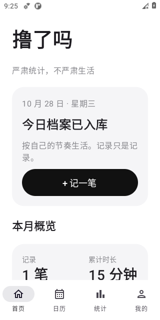
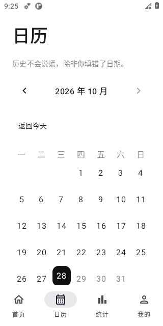
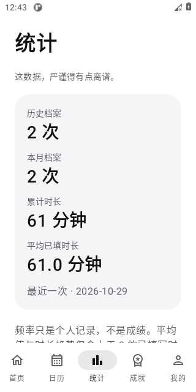
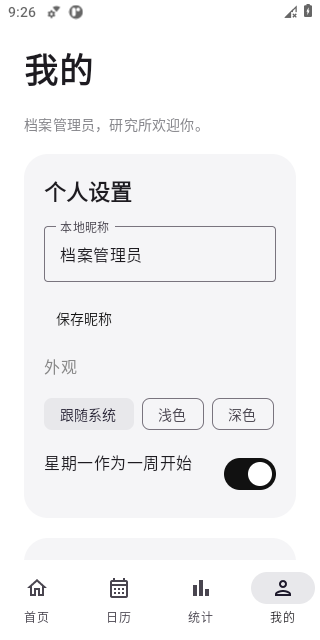
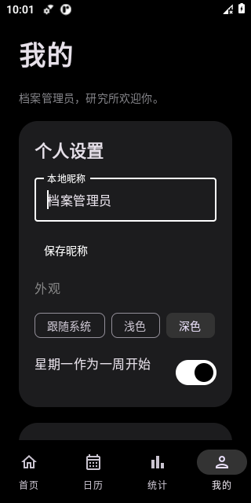

# 撸了吗 · LuLeMa

**一个名字不太正经，记录却异常严谨的开源 Android App。**

*Serious tracking. Ridiculous vibes.*

Android 8.0+ · Kotlin · Jetpack Compose · 完全离线 · MIT

没有账户，没有服务器。只有你与一个一本正经的档案柜。娱乐性记录工具，不提供医学诊断。

## 功能

- **档案**：新增、编辑、二次确认删除、历史补录，同一天多条；日期、可选时间、时长、心情与备注。
- **日历**：月视图、记录标记、每日列表、跨年闰年、星期起始设置、返回今天。
- **统计**：历史 / 本月总览、7 / 30 天趋势、时长变化、每月柱状图、年度热力图与年度报告。
- **小幽默**：原创文案库、标题五连击彩蛋、九项非频率导向成就。
- **个人设置**：本地昵称、跟随系统 / 浅色 / 深色主题、默认关闭的 7–90 天低频提醒。
- **备份**：系统文件选择器、版本化 JSON、默认密码保护、明文隐私提示、导入预览、合并 / 事务覆盖与回滚。

不排名、不羞辱、不鼓励过度行为。频率只是个人记录，不是成绩。

## APK 下载与安装

**[直接下载 APK · v0.1.0-debug.1 测试版](https://github.com/J-Ruan/LuLeMa/releases/download/v0.1.0-debug.1/LuLeMa-v0.1.0-debug.apk)** · [发布说明与校验文件](https://github.com/J-Ruan/LuLeMa/releases/tag/v0.1.0-debug.1)

公开下载无需登录 GitHub。这是开发签名的 Debug 预发布包，不是正式签名稳定版。

- [Actions 构建与 Artifact](https://github.com/J-Ruan/LuLeMa/actions/workflows/android.yml)：成功构建后下载 `LuLeMa-v0.1.0-debug`，登录 GitHub 并解压 ZIP。
- [全部 Releases](https://github.com/J-Ruan/LuLeMa/releases)：已提供 Debug 测试预发布；正式签名版本仍需配置正式密钥并推送稳定版本 Tag。
- 当前环境实际构建 / 安装结果见 [验证报告](docs/VALIDATION.md)。不能把工作流配置存在等同于远端运行成功。

安装：将 APK 下载到 Android 8.0 及以上手机 → 打开文件 → 按系统提示仅为所用文件管理器 / 浏览器允许“安装未知应用” → 安装 → 安装后可关闭该权限。无需注册或网络连接。

升级前先导出备份。不同签名无法覆盖安装，首次从 Debug 切换正式版时先备份、卸载旧版、安装再导入。密码遗失无法恢复加密备份。

## 实际运行截图

以下截图来自 API 30 模拟器中的真实 App，使用人工构造的数据。

| 首页 | 日历 | 统计 | 我的 |
|---|---|---|---|
|  |  |  |  |



测试与设备验证范围见 [验证报告](docs/VALIDATION.md)。

## 本地编译

安装 Android Studio、JDK 21、Android SDK 35 和 Build Tools 35.0.0。在 Android Studio 打开仓库根目录，等待同步；或设置 `ANDROID_HOME` / 本地 `local.properties` 的 `sdk.dir`。

```bash
git clone https://github.com/J-Ruan/LuLeMa.git
cd LuLeMa
chmod +x gradlew
./gradlew :app:testDebugUnitTest :app:lintDebug :app:assembleDebug
```

输出：`app/build/outputs/apk/debug/app-debug.apk`。

只在专用测试设备或模拟器上运行设备测试（会清空或卸载测试 App，不能用于持有真实档案的设备）：

```bash
./gradlew :app:connectedDebugAndroidTest
```

技术栈：Kotlin 2.1.20、Compose / Material 3、Navigation Compose、MVVM / StateFlow、Room、Coroutines、WorkManager、Gradle Kotlin DSL。设置与记录放在同一 Room 数据库，以支持完整事务恢复。详见 [开发文档](docs/DEVELOPMENT.md)。

## 隐私与备份

- 不申请 INTERNET 权限，无广告、追踪、设备标识收集或服务器上传。
- 本机 Room 数据库，默认禁用系统备份和设备迁移。卸载将删除应用数据，请自行备份。
- 提醒默认关闭，Android 13+ 需主动授予通知权限；锁屏文案中性。
- “我的” → 导出 / 导入。密码保护采用 PBKDF2-HMAC-SHA256 + AES-256-GCM；明文文件包含个人隐私。
- 通过系统文件提供器主动选择云盘位置时，文件可能由该提供器上传，请自行判断。
- 数据库依赖 Android 沙箱与设备加密保护，不承诺对抗 Root 或被攻破设备。

备份格式、限制与合并规则见 [备份说明](docs/BACKUP.md)。不要上传真实记录或密码到 Issue。

## 持续维护

提交 PR 或 Push 到 main 会执行单元测试、Lint、Debug 构建和设备测试。Actions 页也支持手动构建。Tag `v*` 在检查通过、四项签名 Secrets 齐全时触发正式签名与 GitHub Release，附 SHA-256；密钥缺失时明确跳过 Release，保留 Debug Artifact。

详见 [发布与维护教程](docs/RELEASING.md)、[更新日志](CHANGELOG.md)、[贡献指南](CONTRIBUTING.md)。当前使用已选择的仓库 `J-Ruan/LuLeMa`，没有另建 `lulema-android` 仓库。

## 许可证

项目采用 [MIT](LICENSE)。品牌「撸」字矢量源于 Noto Sans CJK SC Bold，遵循 [SIL Open Font License](docs/Noto-OFL.txt)，详见 [图标说明](docs/ICON.md)。
